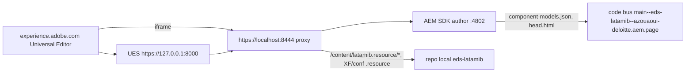

# Latam IB — AEM local + Universal Editor (xwalk)

Site Edge Delivery « xwalk » rendu par l'AEM SDK author local **4802** (instance partagée avec Scotia,
racines séparées) et édité dans le Universal Editor. En-tête et pied de page = composants AEM dans des
Experience Fragments (éditeur classique) ; contenu principal = blocs EDS (Universal Editor).



| Élément | Valeur |
| --- | --- |
| Pages | `/content/latamib/en/index` (template « Latam IB EDS Page », `/conf/latamib`) |
| Header / footer | XF `/content/experience-fragments/latamib/en/site/{header,footer}/master` (projet `aem-latamib`) |
| Mapping nav/footer | feuille de métadonnées en masse `/content/latamib/metadata` (`/content/latamib/en/**`) |
| DAM | `/content/dam/latamib/{global,home}` |
| Cloud config EDS | `/conf/latamib` : owner `azouaoui-deloitte`, repo `eds-latamib`, ref `main` |
| UE service | `https://127.0.0.1:8000` (pas `localhost` : le rewriter Franklin relativise les URL localhost) |
| Proxy | `https://localhost:8444` → `http://localhost:4802`, sert le code local pour les préfixes latamib |

## 1. Prérequis

- AEM SDK author démarré sur 4802 (admin/admin). Ne jamais toucher 4602.
- Démons UES + proxy : `~/ue-service/daemon-start-scotia.sh restart` (redémarre uniquement UES/proxy,
  jamais AEM). Les préfixes latamib (`LATAMIB_PREFIXES`) servent `/content/latamib.resource/`,
  `/content/experience-fragments/latamib/*/*/*/*.resource/` et `/conf/latamib/*/*/*/*/*.resource/`
  depuis `/Users/azouaoui/Documents/eds-latamib`.
- AEM Code Sync installé sur `eds-latamib` : AEM lit `component-models.json` / `head.html` sur le code bus.
  Après chaque push : `curl -s -X POST 'https://admin.hlx.page/code/azouaoui-deloitte/eds-latamib/main/*'`.

## 2. Installer / réinstaller (rejouable)

```bash
cd eds-latamib
bash import-work/tools/ue-setup-aem.sh            # package contenu (pages, DAM, conf EDS) + mapping UE
cd ../aem-latamib
mvn -o clean install -PautoInstallSinglePackage -Daem.port=4802   # composants header/footer, XF, templates
```

Ordre : package EDS d'abord, puis `aem-latamib`. Les filtres s'excluent mutuellement
(`/conf/latamib/settings/wcm` et `/content/latamib/metadata` appartiennent à `aem-latamib`), aucun des deux
ne supprime les nœuds de l'autre. La réinstallation du package EDS remet le contenu de référence
(elle écrase les éditions faites dans le UE).

Après une modification CSS/JS de `blocks/header` ou `blocks/footer` : `node ../aem-latamib/tools/sync-from-eds.mjs`
puis redéployer `aem-latamib` (clientlib `latamib.site` utilisée par l'éditeur des XF).

## 3. Ouvrir les éditeurs

| Quoi | URL |
| --- | --- |
| Page (rendu) | https://localhost:8444/content/latamib/en/index.html |
| Universal Editor | https://experience.adobe.com/#/@deloitte-digitalengage/aem/editor/canvas/localhost:8444/content/latamib/en/index.html |
| XF header (éditeur classique) | http://localhost:4802/editor.html/content/experience-fragments/latamib/en/site/header/master.html |
| XF footer (éditeur classique) | http://localhost:4802/editor.html/content/experience-fragments/latamib/en/site/footer/master.html |
| Console Sites | http://localhost:4802/sites.html/content/latamib |

Accepter d'abord les certificats auto-signés : https://127.0.0.1:8000/ping et https://localhost:8444/.

## 4. Modèle de contenu (UE)

Sections avec style (`Section > Style`), blocs génériques réutilisables : voir
[block-map.md](migration/block-map.md). Le bloc `metadata` de section est une ressource virtuelle du
composant section Franklin : retiré par la décoration, le style s'édite sur la section.

## 5. Vérifications

```bash
cd import-work/tools
node ue-instrumentation.mjs                                   # data-aue-* avant / après décoration
node pp-compare.mjs https://localhost:8444/content/latamib/en/index.html --label=aem   # ±3px, 5 viewports
node states-compare.mjs https://localhost:8444/content/latamib/en/index.html --label=aem
```

Test `/update` sans IMS (temporaire, port 8001, à arrêter ensuite) :
`UES_PORT=8001 UES_DISABLE_IMS_VALIDATION=true UES_PRIVATE_KEY=… UES_CERT=… node ~/ue-service/universal-editor-service.cjs`,
puis `POST https://localhost:8001/update` avec la connexion `xwalk:https://localhost:8444`.

## 6. Limites

- La source de contenu Helix du site xwalk pointe vers `https://localhost:8444` : les aperçus
  aem.page / aem.live du contenu xwalk ne fonctionnent pas (le rendu cible est AEM local). La publication
  vers admin.hlx.page depuis AEM local reste désactivée.
- Les liens de menu autres que « Home » pointent vers latamib.com (pages non migrées).
