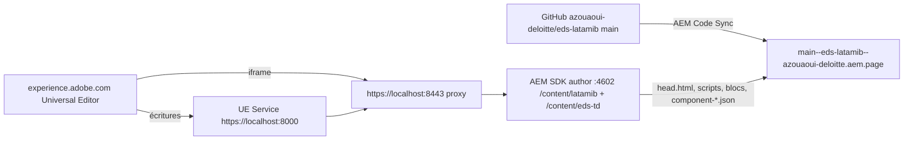

# Latam IB — AEM local + Universal Editor (xwalk)

Les pages Latam IB sont stockées dans le SDK AEM as a Cloud Service local et éditées dans le Universal Editor (UE).
Le rendu utilise le code EDS de ce dépôt. AEM le lit sur le *code bus* `https://main--eds-latamib--azouaoui-deloitte.aem.page`
(proxy `/content/latamib.resource/...`).

Ce montage partage les services locaux de la démo TD (`/content/eds-td`) : il les **étend**, sans les remplacer.



## 1. Prérequis (une fois)

1. **Dépôt GitHub** `azouaoui-deloitte/eds-latamib` : le dépôt a été généré sous `azizzouaouiaem` puis son transfert
   vers `azouaoui-deloitte` a été demandé. Un transfert entre comptes personnels doit être **accepté** depuis l'e-mail
   GitHub reçu par `azouaoui-deloitte`.
2. **AEM Code Sync** (déjà installée sur `azouaoui-deloitte`) : après le transfert, vérifier ou déclencher la
   synchronisation du code :

   ```bash
   curl -s https://admin.hlx.page/status/azouaoui-deloitte/eds-latamib/main/
   curl -X POST "https://admin.hlx.page/code/azouaoui-deloitte/eds-latamib/main/*"
   curl -s -o /dev/null -w "%{http_code}\n" https://main--eds-latamib--azouaoui-deloitte.aem.page/scripts/scripts.js   # 200 attendu
   ```

3. Services locaux de la démo TD : `~/ue-service` (UE Service `universal-editor-service.cjs` sur 8000 et proxy
   `aem-https-proxy.cjs` 8443 → 4602). Le proxy est générique (tous chemins) : aucune modification n'est nécessaire.

## 2. Installer le site dans AEM (rejouable)

AEM author `http://localhost:4602` démarré (admin/admin), puis :

```bash
~/ue-service/start-ue-local.sh start          # UES 8000 + proxy 8443 (ou status / restart)
import-work/tools/ue-setup-aem.sh              # paquet + réglages OSGi + vérifications
```

`ue-setup-aem.sh` enchaîne :

1. `node import-work/tools/ue-build-package.mjs` → `import-work/ue/latamib-xwalk-content-1.0.0.zip`
   (paquet **`latamib:latamib-xwalk-content:1.0.0`**, filtres en mode *replace*) ;
2. upload + installation via `/crx/packmgr/service.jsp` ;
3. réglages OSGi (idempotents, valeurs identiques à la démo TD + l'entrée latamib) :

| PID | Valeur | Effet |
|---|---|---|
| `com.adobe.aem.wcm.franklin.internal.UniversalEditorSettings` | `endpoint=https://localhost:8000` | `<meta name="urn:adobe:aue:config:service">` |
| `com.day.cq.commons.impl.ExternalizerImpl` | `author https://localhost:8443` | `<meta name="urn:adobe:aue:system:aemconnection" content="xwalk:https://localhost:8443">` |
| `com.day.cq.wcm.core.impl.UniversalEditorURLServiceImpl` | `/content/eds-td:${author}${path}.html` **et** `/content/latamib:${author}${path}.html` | « Modifier » dans la console Sites ouvre le UE pour les deux sites |
| `com.adobe.aem.wcm.franklin.internal.hlx.HelixAdminClientImpl` | `adminApiBaseUri=https://localhost:1/…` | aucun preview/publish vers admin.hlx.page depuis le SDK |

4. contrôles : page rendue via le proxy, méta UE, `data-aue-resource`, `nav` / `footer`, code bus, site TD toujours servi.

Contenu du paquet :

| Chemin | Contenu |
|---|---|
| `/conf/latamib/settings/cloudconfigs/edge-delivery-service-configuration` | Edge Delivery Services : propriétaire `azouaoui-deloitte`, dépôt `eds-latamib`, branche `main`, script auxiliaire `editor-support.js` |
| `/content/latamib` | racine du site (`cq:conf=/conf/latamib`, gabarits `/libs/core/franklin/templates/*`, langue `en`) |
| `/content/latamib/index` | accueil : 6 sections (hero, About, Services, Senior Bankers, Experience, CTA), métadonnées (titre, description, `image`, `nav`, `footer`) |
| `/content/latamib/nav`, `/content/latamib/footer` | en-tête et pied de page |
| `/content/dam/latamib/{home,global}` | 11 images (voir `docs/migration/latamib-home.md` §5) |

Variables : `EDS_OWNER`, `EDS_REPO`, `EDS_BRANCH`, `PKG_VERSION`, `AEM_URL`, `PROXY_URL`. **Réinstaller le paquet
écrase les modifications faites dans AEM** (mode *replace*) : c'est aussi la remise à zéro de la démo.

Le paquet est généré à partir du HTML d'import (balisage EDS) de `import-work/content/latamib/*.plain.html` et des
fichiers de `import-work/content/dam/latamib` : modifier ces sources puis relancer le script.

## 3. Ouvrir le Universal Editor

1. `https://localhost:8000/ping` puis `https://localhost:8443/content/latamib/index.html` : accepter les certificats auto-signés.
2. Ouvrir l'URL ci-dessous avec un Adobe ID ayant accès au UE ; dans Chrome, **autoriser l'accès au réseau local**
   pour experience.adobe.com.

| Page | Universal Editor |
|---|---|
| Accueil | https://experience.adobe.com/#/aem/editor/canvas/localhost:8443/content/latamib/index.html |
| Navigation (en-tête) | https://experience.adobe.com/#/aem/editor/canvas/localhost:8443/content/latamib/nav.html |
| Pied de page | https://experience.adobe.com/#/aem/editor/canvas/localhost:8443/content/latamib/footer.html |

Console Sites : `http://localhost:4602/sites.html/content/latamib`.

## 4. Modèle de contenu dans le UE

| Élément | Composant / champs |
|---|---|
| Section | *Style* (multisélection) : `centered`, `dark`, `teal`, `grey`, `fluid`, `split`, `services`, `team`, `experience`, `cta-band` |
| Sur-titre (« // About ») | Texte : paragraphe court juste avant un titre H2 |
| Titre / texte / image / bouton | composants par défaut ; Bouton *primary* = orange, *secondary* = lien flèche |
| Hero | image, texte alternatif, richtext (H1 + lien **gras** = bouton) |
| Cards | variante `services` ou `team` ; éléments *Card* (image/icône, alt, richtext) — ajout / suppression / déplacement |
| Image Link | image, alt, lien |
| Call to Action | image de fond, alt, richtext (H2 + lien ***gras italique*** = bouton contour) |
| Columns | composant Columns natif (About) |
| Page | titre, description, image sociale, page nav, page footer, mots-clés |
| En-tête (`nav`) | section 1 : 2 images (logo desktop, mobile) ; section 2 : liste de liens ; section 3 : liens `:linkedin:` et `:search:` |
| Pied (`footer`) | logo ; liste de liens ; paragraphes icône `:globe:` / `:phone:` + H6 + texte ; mentions |

## 5. Développement sans AEM

```bash
node import-work/tools/build-local.mjs                    # documents complets (doctype) + DAM dans content/ (ignoré par git)
aem up --html-folder content --no-open --port 3001         # http://localhost:3001/content/latamib/index
node import-work/tools/measure-page.mjs https://latamib.com/ http://localhost:3001/content/latamib/index desktop
node import-work/tools/ue-mock-check.mjs                   # instrumentation UE simulée conservée après décoration
```

## 6. Limites

- Pas de publication depuis le SDK local (Admin API coupée volontairement, cf. TD).
- Le canvas UE exige une connexion Adobe IMS. Les vérifications automatiques portent sur la page instrumentée et sur le UE Service.
- Le post-traitement richtext d'AEM supprime les images liées (`<a>`) : les logos sont des composants Image et
  le lien du logo est construit par le bloc header.
